# Wall Dashboard dla Home Assistant

Dashboardy na tablety ścienne, panele PoE i telefony. Zawiera:
- **kiosk** dla tabletów: link z kluczem, tylko podgląd i sterowanie, bez dostępu do ustawień HA;
- **edytor wizualny** w panelu bocznym Home Assistant;
- dzwonek z furtki i interkom (go2rtc albo centrala SIP);
- własne motywy;
- opcjonalnie aplikację kiosk na Androida.

[](https://my.home-assistant.io/redirect/supervisor_add_addon_repository/?repository_url=https%3A%2F%2Fgithub.com%2Fwirczur%2Fha-wall-dashboard)

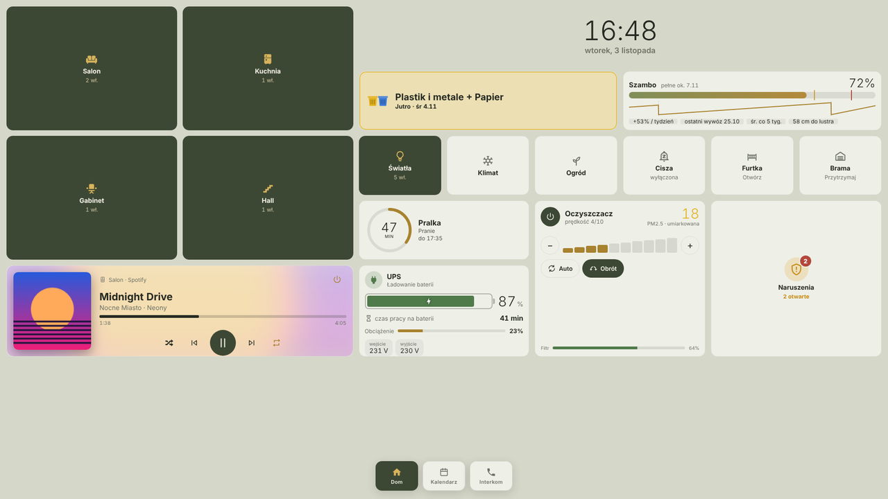

| Szkło (ciemny) | Własny motyw („Grafit”) |
|---|---|
| 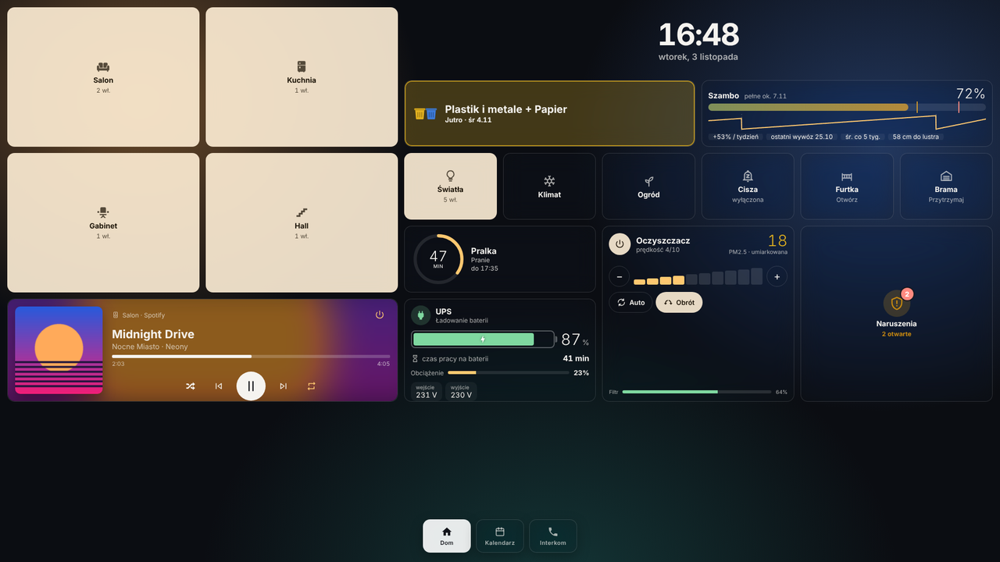 | 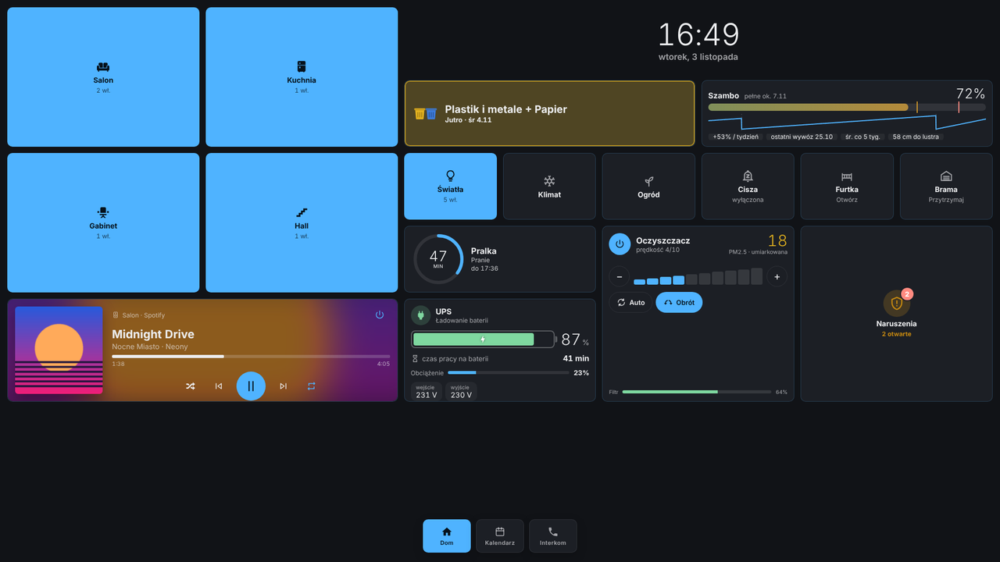 |
| **Panel boczny pokoju** (klimatyzacja, światła, TV, oczyszczacz) | **Dzwonek z furtki** (kamera, rozmowa, „Otwórz”) |
| 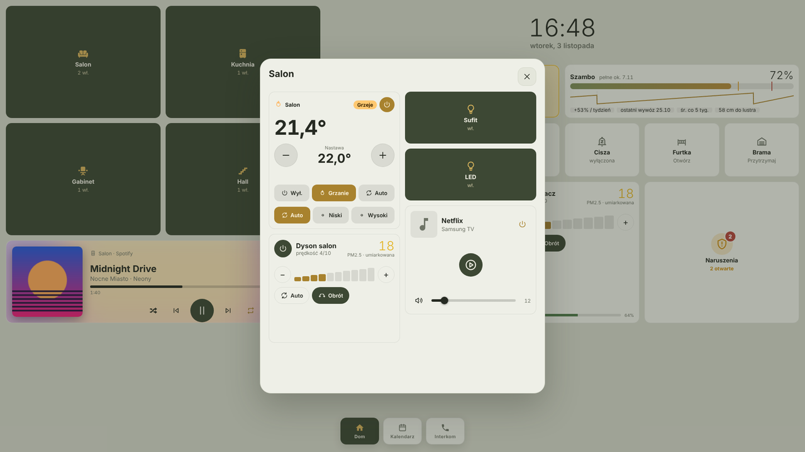 | 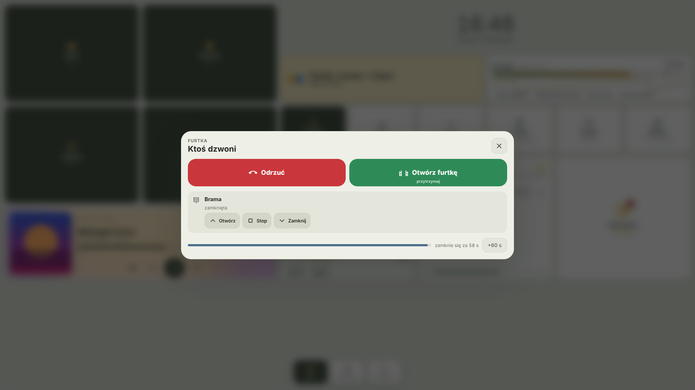 |
| **Ogród** (Rain Bird, kosiarka) | **Edytor w Home Assistant** |
| 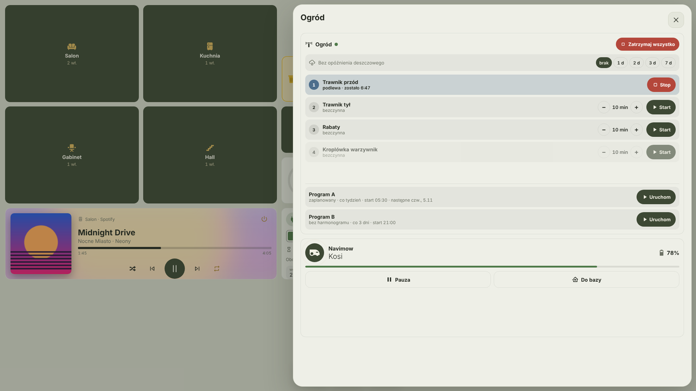 | 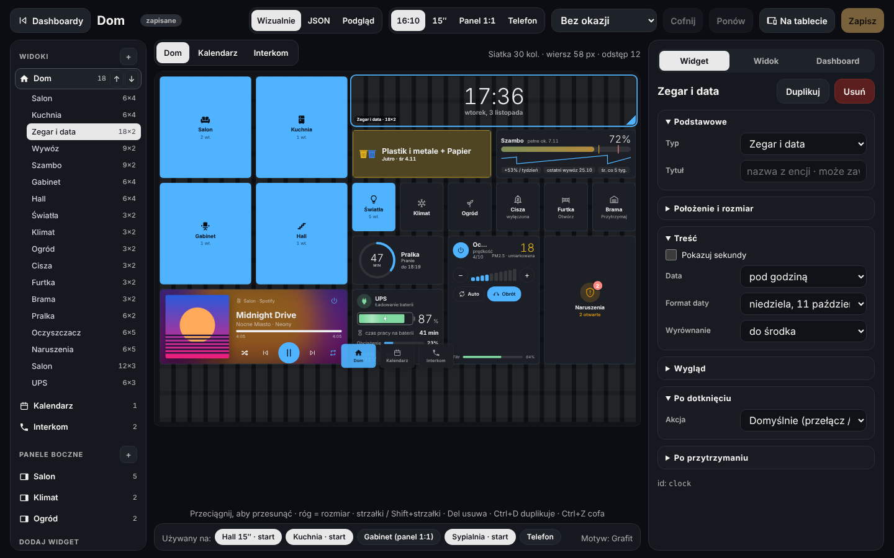 |
| **Panel zarządzania – Stan** (panele online, centrala, dzwonki, ostrzeżenia) | **Tablety** (stan na żywo, ustawienia w zakładkach) |
| 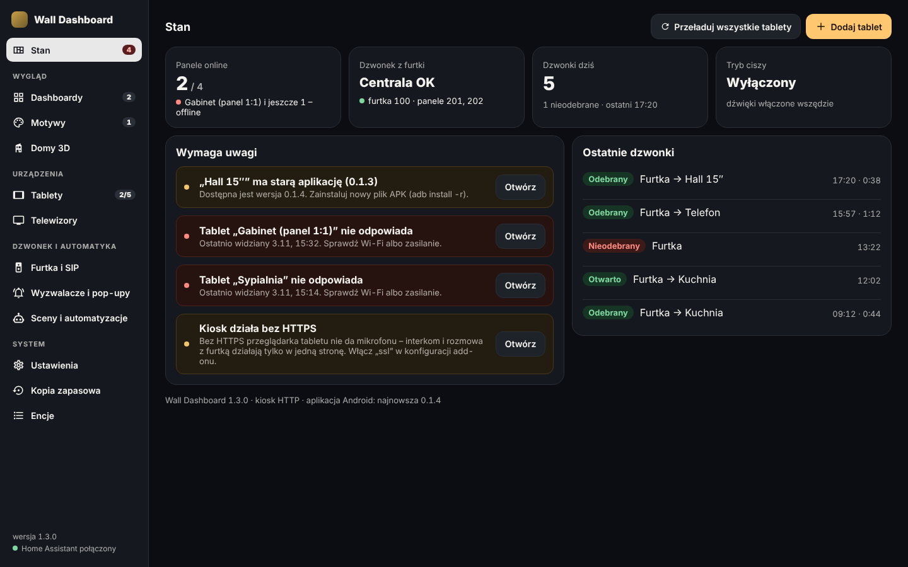 | 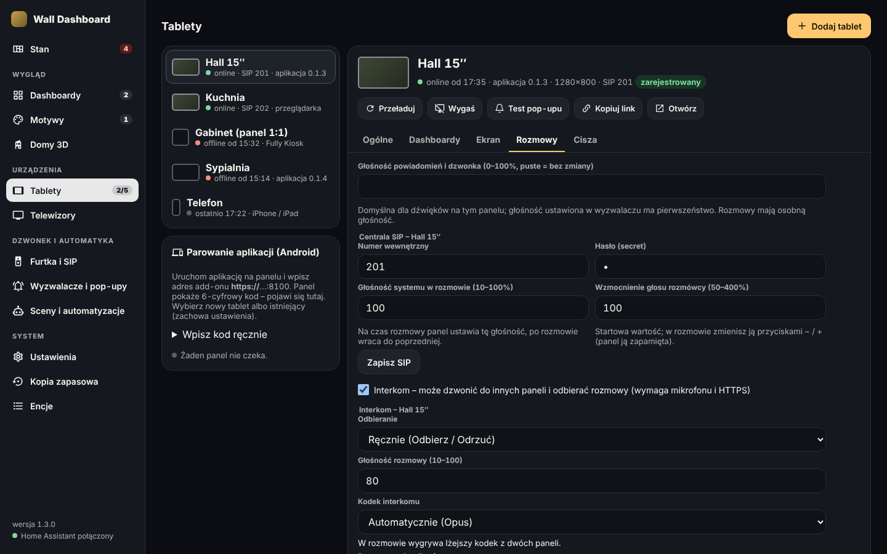 |
| **Dashboardy** (miniatury, „używany na”, szablony) | **Motywy – edytor z podglądem** |
| 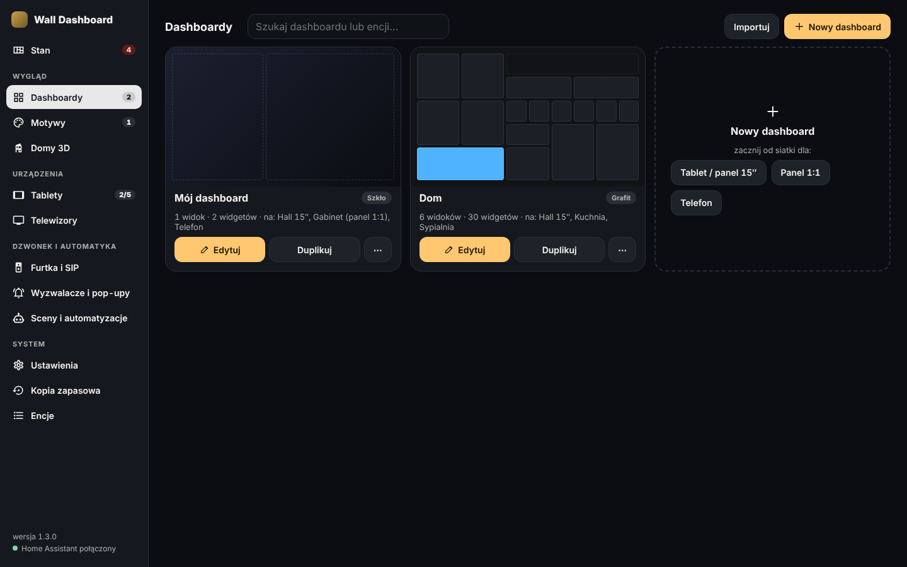 | 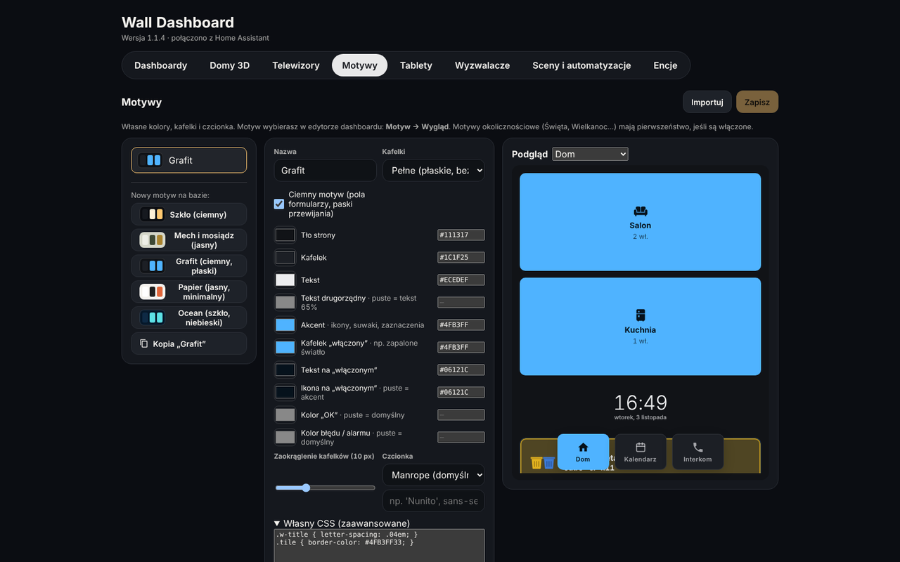 |
| **Telefon** (jedna kolumna, PWA) | |
| 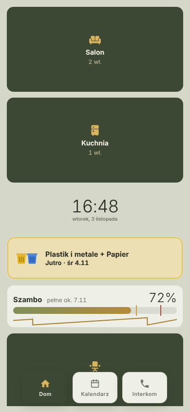 | |

> Zrzuty pochodzą z przykładowego domu z danymi testowymi.

---

## Instalacja w Home Assistant

Wymagany **Home Assistant OS** albo **Supervised**, bo tylko te wersje obsługują dodatki. Architektury: amd64, aarch64, armv7.

1. Kliknij przycisk **„Dodaj repozytorium”** powyżej. Możesz też zrobić to ręcznie: **Ustawienia → Dodatki → Sklep z dodatkami → ⋮ → Repozytoria** i wklej:
   ```
   https://github.com/wirczur/ha-wall-dashboard
   ```
2. Odśwież sklep (⋮ → Sprawdź aktualizacje) → **Wall Dashboard** → **Zainstaluj**.
3. Włącz **Pokaż na pasku bocznym** i **Uruchom**.
4. Otwórz **Wall Dashboard** z paska bocznego HA. Dashboard startowy już tam jest.

Aktualizacje pojawiają się w HA automatycznie, jak przy każdym dodatku.

> **Repozytorium prywatne:** Home Assistant pobiera repozytoria dodatków bez logowania, więc prywatne repozytorium trzeba albo upublicznić, albo dodać z tokenem GitHuba (tylko odczyt, „Fine-grained token” → *Contents: Read*):
> `https://<TOKEN>@github.com/wirczur/ha-wall-dashboard`.
> Token jest wtedy zapisany w konfiguracji HA.

> HACS obsługuje integracje i karty, a nie dodatki. Wall Dashboard instaluje się z repozytorium jak wyżej.

### Instalacja lokalna (bez GitHuba)
Skopiuj folder [`wall_dashboard`](wall_dashboard) do udziału **`addons`** w HA, np. przez dodatek Samba albo SSH. Potem w Sklepie z dodatkami wybierz **⋮ → Sprawdź aktualizacje**. Dodatek pojawi się w sekcji „Dodatki lokalne”.

---

## Pierwsze kroki
1. **Dashboard:** Wall Dashboard → *Dashboardy* → *Edytuj*. Widgety dodajesz z galerii (**+ Dodaj widget**), przeciągasz i zmieniasz ich rozmiar na siatce. Podgląd jest dostępny dla tabletu 16:10, 15″, panelu 1:1 i telefonu.
2. **Tablet:** *Tablety* → **Dodaj tablet** → wybierz dashboardy → **Kopiuj link** i otwórz go na tablecie. Zamiast linku możesz sparować aplikację na Androida kodem.
3. **Adres kiosku:** port **8100**. Dla mikrofonu (interkom, dzwonek SIP) włącz HTTPS w konfiguracji dodatku (`ssl: true` z certyfikatem z `/ssl`).

Pełna instrukcja jest w zakładce **Dokumentacja** dodatku ([wall_dashboard/DOCS.md](wall_dashboard/DOCS.md)).

## Co potrafi
- **Widgety:**
  - światła, przełączniki, rolety, sceny i przyciski z akcjami (dotknięcie, przytrzymanie);
  - klimatyzacja i termostaty (także z kilku encji, z jonizacją i trybem turbo);
  - odtwarzacze (HEOS, Sonos, TV), kalendarz, pogoda, wywóz śmieci, szambo, UPS;
  - AGD (pralka, suszarka), oczyszczacze, nawadnianie (Rain Bird), kosiarka i odkurzacz;
  - alarm (Satel), harmonogramy (Scheduler), kamery (WebRTC / MSE / HLS);
  - pilot TV Samsung, interkom, historia dzwonków;
  - dom 3D z rzutów SVG.
- **Panele boczne i pop-upy:**
  - kafelek otwiera listę encji albo cały widok (np. pokój);
  - pop-upy z automatyzacji HA (np. dzwonek): budzą ekran, odtwarzają dźwięk, pokazują kamerę i przycisk „Otwórz furtkę”.
- **Panel zarządzania w HA:** strona *Stan* z ostrzeżeniami, tablety ze stanem na żywo, miniatury dashboardów, edytor ze strukturą widoków, podglądem motywów okolicznościowych i wysyłką niezapisanej wersji na wybrany tablet.
- **Wygląd:**
  - wbudowane motywy: Szkło, Mech i mosiądz;
  - motywy okolicznościowe (Święta, Wielkanoc, Halloween, Walentynki);
  - **własne motywy:** kolory, kafelki pełne lub szklane, zaokrąglenie, czcionka, własny CSS, import i eksport JSON;
  - tryb **Lite** dla słabych paneli.
- **Dzwonek z furtki**, do wyboru:
  - **po staremu:** wyzwalacz z HA, obraz i rozmowa przez go2rtc, poczekalnia z muzyką i automatycznym rozłączaniem;
  - **przez centralę SIP (VitalPBX / Asterisk):** panele i telefony są numerami wewnętrznymi, centrala obsługuje IVR i grupę dzwonienia, telefon dostaje powiadomienie push z aplikacji HA i przejmuje połączenie.
- **Interkom między panelami** (WebRTC w sieci lokalnej), tryb ciszy z harmonogramem, osobna głośność rozmów i powiadomień.
- **Telefony i iPady:** ten sam dashboard jako aplikacja z ekranu początkowego (PWA), poza domem przez VPN.
- **Bezpieczeństwo:**
  - tablet widzi i steruje tylko encjami ze swoich dashboardów;
  - klucz tabletu można w każdej chwili unieważnić;
  - edytor jest dostępny tylko przez panel HA (ingress).

## Aplikacja kiosk na Androida (opcjonalnie)
Osobna aplikacja (WebView) zamiast Fully Kiosk Browser. Działa na Androidzie 10+, także bez usług Google. Daje:
- parowanie 6-cyfrowym kodem (bez QR);
- wygaszacz, wyłączanie ekranu i zegar nocny;
- polecenia z HA (`wall_dashboard_command`);
- głośnik dla rozmów SIP;
- tryb kiosku (Device Owner).

Plik APK jest w wydaniach repozytorium aplikacji. Instalacja: `adb install -r WallDashboard-x.y.z.apk`.

## Wymagania i porty
| | |
|---|---|
| Home Assistant | OS / Supervised, 2024.x lub nowszy |
| Port 8100 | kiosk dla tabletów (HTTP lub HTTPS) |
| go2rtc (opcjonalnie) | kamery na żywo i rozmowa z domofonem, API na porcie 1984 |
| Centrala SIP (opcjonalnie) | VitalPBX / Asterisk z WebSocket SIP (`ws://IP:8088/ws`) |

## Rozwój
```sh
cd wall_dashboard/app
npm ci
npm run typecheck
npm run build          # dist/server + dist/web – to kopiuje Dockerfile
HA_URL=http://homeassistant.local:8123 HA_TOKEN=<token> DATA_DIR=./data npm start
# edytor: http://localhost:8099   kiosk: http://localhost:8100/?k=<klucz tabletu>
```

## Licencja
MIT – patrz [LICENSE](LICENSE). Modele mebli 3D: [Kenney](https://kenney.nl) (CC0). SIP w przeglądarce: [JsSIP](https://jssip.net) (MIT).
