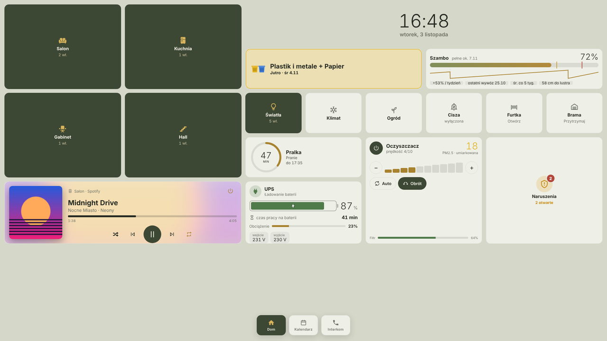

# Wall Dashboard

Dashboardy na tablety ścienne dla Home Assistant:
- **kiosk** dla tabletów: link z kluczem, tylko podgląd i sterowanie;
- **edytor** w panelu bocznym HA;
- dzwonek z furtki (go2rtc albo centrala SIP), interkom między panelami;
- własne motywy.



Instrukcja jest w zakładce *Dokumentacja* dodatku ([DOCS.md](DOCS.md)). Opis i zrzuty ekranu znajdziesz w [README repozytorium](https://github.com/wirczur/ha-wall-dashboard).

## Budowanie ze źródeł
```sh
cd app
npm ci
npm run typecheck
npm run build       # dist/server + dist/web – to kopiuje Dockerfile
```
